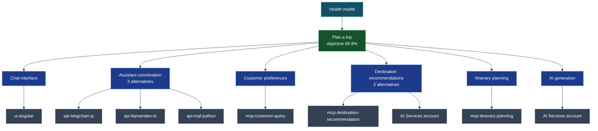

# Health model

`azd up` deploys an [Azure Monitor health model](https://learn.microsoft.com/azure/azure-monitor/health-models/overview) next to the application. It shows whether people can plan a trip, and which service is the reason when they can't.

The model is defined in [`infra/modules/healthmodel.bicep`](../infra/modules/healthmodel.bicep) and is named `hm-<resource token>` in the application's resource group.

## Topology



- The trip flow and single-dependency components take the worst state of their children.
- The three assistants are alternatives: one non-healthy assistant makes *Assistant coordination* Degraded, all three make it Unhealthy.
- Destinations come from the MCP server or from AI, depending on the assistant. One non-healthy source is Degraded, both are Unhealthy.
- `mcp-echo-ping` is a test tool and is not part of the flow.

## Signals

All signals use a 5-minute window and refresh every minute.

| Signal | Applies to | Degraded | Unhealthy |
|--------|------------|----------|-----------|
| Running replicas (`Replicas`) | Container Apps | below 1 | below 0.5 |
| AI request availability (`AzureOpenAIAvailabilityRate`) | AI Services | below 99% | below 95% |
| Resource Health | AI Services | platform reported | platform reported |
| Container crashes | Container Apps | above 0 | above 3 |
| Logged assistant or required tool failures | the three assistants | above 0 | above 3 |

- *Container crashes* counts `ContainerTerminated` events in `ContainerAppSystemLogs_CL` where the process exited with a non-zero code. Planned revision replacements and failed startup probes are not counted.
- *Logged assistant or required tool failures* counts lines in `ContainerAppConsoleLogs_CL` that match the error messages the assistants log when a chat fails or when the customer query, itinerary or (except Python) destination MCP server can't be reached. It counts log lines, not failed requests.

The trip flow raises a Sev2 alert when Degraded and a Sev1 alert when Unhealthy. No action group is attached, so alerts are visible in Azure Monitor but nobody is notified.

## Requirements

- The deployer needs permission to create role assignments (Owner or User Access Administrator), as for the rest of this template.
- The model's system-assigned identity gets **Reader** on the resource group and **Monitoring Reader** on the Log Analytics workspace.
- The region must support `Microsoft.CloudHealth/healthmodels`. The model uses `AZURE_LOCATION` by default. When that region has no health models, pick a supported one; the model can monitor resources in another region:

  ```bash
  az provider show -n Microsoft.CloudHealth --query "resourceTypes[?resourceType=='healthmodels'].locations" -o tsv
  ```

  ```bash
  azd env set AZURE_HEALTH_MODEL_LOCATION swedencentral
  ```

- Local Bicep reports `BCP081` warnings for the `Microsoft.CloudHealth` types. They don't block the deployment.

## Limitations

- A Healthy model means the services run and AI answers; it doesn't prove that a chat produced a correct itinerary.
- *AI request availability* is Unknown until the AI deployment serves requests. Resource Health still reports on the account.
- Log signals see an error a few seconds to minutes after it happens, depending on Log Analytics ingestion.
